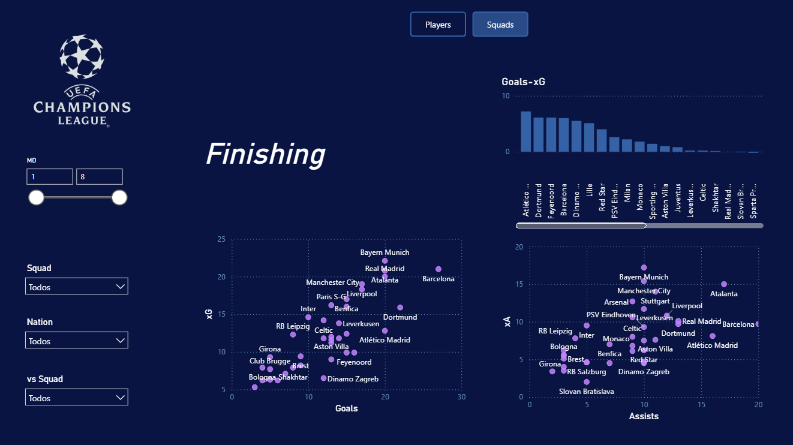
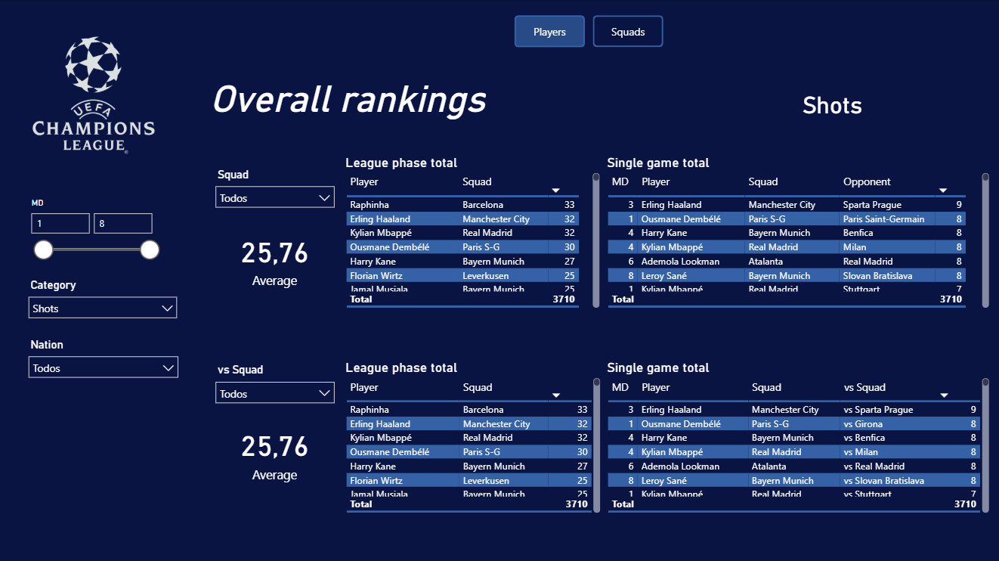

# Uefa Champions League 2024/25 Analysis


Analysis of the UEFA Champions League 2024/25 League Phase using Python and Power BI. The project covers data extraction and transformation, a custom territorial-dominance metric (Field Tilt), and an interactive report exploring team and player performance.

[Click here to access the Power BI report](https://app.powerbi.com/view?r=eyJrIjoiNTQ0OGQyZDItM2IxYS00YWYyLWJhZWUtOTZlZTJlNzAzY2I2IiwidCI6ImFmNmE0MmI1LWJkMGUtNDUwNS1iMDdmLWY5MTdiMGNlMmYzZCJ9&language=en-US)






## Report Overview

The report has eight pages. Seven of them have a **Players** view and a **Squads** view, which you can switch with the buttons at the top. The **Field tilt** page has no such switch because the metric is defined at team level. The slicers on the left filter by matchday range (MD), category, squad, nation, or opponent.

- **Overall rankings**: league-phase totals and single-game records for any stat, for each squad and for the opponents it faced.
- **Evolution**: how a stat changes matchday by matchday.
- **Share of participation**: each player's or squad's share of a stat, shown as a treemap.
- **Finishing**: goals and assists compared with expected values (xG and xA).
- **Penalty area presence**: shots, touches, carries and passes in the penalty area, plus shot accuracy.
- **Build-up**: crosses, passes attempted and the mix of long and short passes.
- **Field tilt**: match-level and cumulative territorial dominance, with a matchday selector.
- **Defense**: tackles, interceptions, aerial duels and where tackles happen on the pitch.

## Objectives

- Analyze individual player statistics and team performances during the 2024/25 Champions League League Phase.
- Extract, clean, and consolidate match and player data from FBref.
- Calculate Field Tilt to measure each team's share of touches in the attacking third.
- Build a structured dataset to support interactive visualizations and performance analysis in Power BI.

## Technologies Used

* **Python (pandas)**: data extraction, cleaning, merging, metric calculation and CSV processing.
- **Google Colab:** notebook execution and Google Drive integration.
- **Power BI:** data modeling, interactive reports, and visualizations.

## Data Processing and Methodology

The project is organized into three main Python notebooks:

### 1. Extracting Player Statistics

The `extracting-stats.ipynb` notebook collects player statistics from individual match pages on FBref. It extracts tables covering different aspects of player performance, merges the relevant data, removes aggregate player rows, standardizes column names, and adds match identifiers, matchday information, and team names.

The resulting dataset consolidates player performances across the competition.

### 2. Calculating Field Tilt

The `field-tilt.ipynb` notebook uses the consolidated player statistics to calculate Field Tilt for each team in each match.

Field Tilt measures a team's territorial dominance in a match as its share of all touches in the attacking third by both teams:

```
Field Tilt = team touches in the attacking third / total touches in the attacking third by both teams
```

The notebook also calculates a **cumulative** Field Tilt across the matches played so far. It adds up the team's attacking-third touches and the total attacking-third touches of those matches, then divides one by the other (sum over sum), instead of averaging match percentages. Matches with more activity therefore weigh more than in a simple average. Results are converted to percentages and rounded to two decimal places.

### 3. Extracting Match Fixtures

The `extracting-fixtures.ipynb` notebook retrieves match information from FBref's Champions League fixtures table. It removes incomplete or duplicated header rows, separates home and away scores, and renames expected-goals columns for clarity.

The fixture data provides match-level context that complements the player statistics and Field Tilt calculations.

## Reproducibility Note

**At the time of writing, FBref does not allow automated extraction of its data.** For this reason, `extracting-stats.ipynb` and `extracting-fixtures.ipynb` cannot be re-run as originally written. They are kept in the repository to document how the data was collected.

Everything downstream can still be reproduced from the processed files in `complete-data/`:

* `field-tilt.ipynb` reads the processed statistics CSV directly from this repository, so it runs without access to FBref.
* The Power BI project in `.pbip-files/` uses the same CSVs.

## Data Sources

- [FBref – Uefa Champions League](https://fbref.com/en/comps/8/Champions-League-Stats): match reports, player statistics, and fixtures.
- [Complete datasets](complete-data/): processed CSV files used in the project.

## Project Structure

- `python-notebooks/extracting-stats.ipynb`: extracts, cleans, and consolidates player statistics.
- `python-notebooks/field-tilt.ipynb`: calculates match-level and cumulative Field Tilt.
- `python-notebooks/extracting-fixtures.ipynb`: extracts and cleans match fixtures and results.
- `complete-data/statsucl2425.csv`: consolidated player statistics.
- `complete-data/fieldtiltucl2425.csv`: Field Tilt data.
- `complete-data/fixturesucl2425.csv`: match fixtures and results.
- `.pbip-files/`: Power BI report and semantic model project files.
- `pbipucl2425.pbip`: Power BI Project entry file.
- `images/`: screenshots of the report used in this README.

